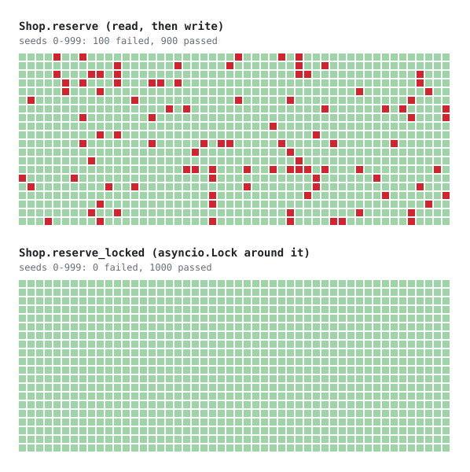
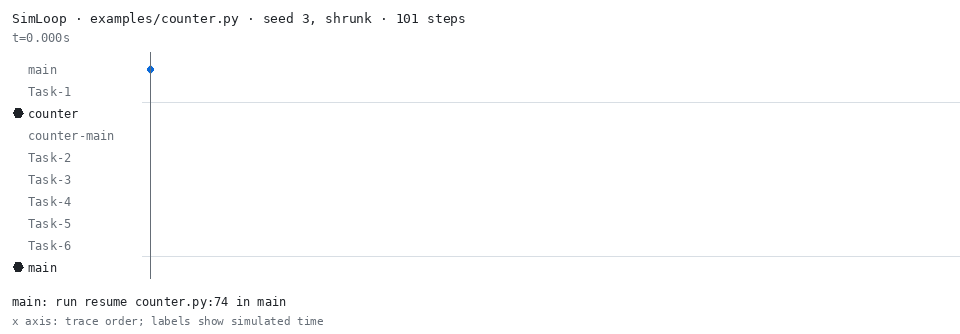

# SimLoop

[](https://github.com/Usman-Siddiqi/SimLoop/actions/workflows/ci.yml)


**Deterministic simulation testing for Python asyncio.**

SimLoop runs your asyncio code on an event loop it fully controls: simulated
time, seeded scheduling, seeded randomness, a simulated network, and seeded
fault injection (crashes, partitions, resets, pauses, clock jumps). You
explore thousands of executions in seconds, any failure replays exactly from
its seed, and failures shrink to the simplest run that still shows the bug.

It has already found a previously unreported bug in a popular aio-libs
package ([Findings](#findings)).

> Status: alpha. The core, network, faults, shrinking, CLI and pytest plugin
> work and are tested on Python 3.11 to 3.14. See [ROADMAP.md](ROADMAP.md)
> for what is next.

## Why deterministic simulation testing

Concurrency bugs hide in interleavings that only happen under particular
timing: two requests that overlap by a few milliseconds, a timeout that fires
just before a reply, a retry that races a reconnect. Ordinary tests run one
interleaving, the one your laptop happens to produce, and a failure seen once
in CI is often impossible to reproduce.

Deterministic simulation testing, the approach behind FoundationDB's and
TigerBeetle's test suites, takes every source of non-determinism away from
the OS and gives it to a seeded random generator. Then:

- a run is a pure function of its seed, so every failure is reproducible;
- simulated time costs nothing, so an hour of timeouts and retries runs in milliseconds;
- the scheduler can deliberately explore interleavings instead of waiting for them.

## Example: catching a race and replaying it

[`examples/inventory.py`](examples/inventory.py) is a small shop. Four
customers arrive at random times and reserve stock through a database with
random 2 to 20 ms latency:

```python
async def reserve(self, quantity: int) -> bool:
    stock = await self.db.read_stock()
    if stock < quantity:
        return False
    await self.db.write_stock(stock - quantity)  # stock may have changed since the read
    self.sold += quantity
    return True
```

The test states what must always be true, using the simulation's random
generator for arrival times and latencies:

```python
simloop.always(lambda: db._stock + shop.sold == INITIAL_STOCK, "no stock is lost")
```

Exploring 1000 seeds (output from a real run):

```
$ simloop explore examples/inventory.py:main --seeds 1000 --trace-last 0
1000 runs, 900 passed, 100 failed in 0.70s (1419 runs/s, 772.3s simulated, 31614 steps)

[1] invariant: always 'no stock is lost' was violated
    signature: invariant:no stock is lost
    seeds: 4, 7, 25, 30, 32, 61, 68, 74, 82, 85, ... (100 total)

reproduce [invariant]: simloop run examples/inventory.py:main --seed 4
```

Seed 4 fails the same way every time, and the trace shows why:

```
$ simloop run examples/inventory.py:main --seed 4 --trace-last 14
FAILED (seed 4) after 25 steps, t=0.134520s

invariant: always 'no stock is lost' was violated

Last 14 trace events:
        time    step  actor   event
                      ...     (32 earlier events)
    0.118093      20  Task-1  run      resume inventory.py:30 in Database.read_stock
    0.118093      20  Task-1  log      read stock=8
    0.123308      21  loop    timer    _set_result_unless_cancelled
    0.123308      22  Task-2  run      resume inventory.py:34 in Database.write_stock
    0.123308      22  Task-2  log      wrote stock=5
    0.123308      22  Task-2  log      reserved
    0.123308      22  Task-2  done     returned
    0.123308      23  loop    run      TaskGroup._on_task_done
    0.134520      24  loop    timer    _set_result_unless_cancelled
    0.134520      25  Task-1  run      resume inventory.py:34 in Database.write_stock
    0.134520      25  Task-1  log      wrote stock=4
    0.134520      25  Task-1  log      reserved
    0.134520      25  Task-1  done     returned
    0.134520      25  sim     failed   always 'no stock is lost' was violated

trace digest c1fa8d41d08ee8b6a9d9b0bf09619889
```


Wrapping the read-modify-write in an `asyncio.Lock` fixes it, and the same
1000 seeds confirm the fix:



Both images are generated from real runs by
[`scripts/render_visuals.py`](scripts/render_visuals.py).

### Shrinking: the simplest run that still fails

Seed 4's arrival times are random noise around the actual bug. `--shrink`
replays edited versions of the run's recorded choices and keeps the simplest
one that fails the same way, then saves it so it can be replayed later:

```
$ simloop explore examples/inventory.py:main --seeds 1000 --shrink --save
...
[invariant] invariant:no stock is lost
shrunk in 2 runs (0.00s): 12 -> 0 choices, 25 -> 23 steps, t=0.134520s -> t=0.004000s
saved reproduction: .simloop/failures/invariant-no-stock-is-lost-seed4.json
replay with: simloop replay .simloop/failures/invariant-no-stock-is-lost-seed4.json
```

Zero choices means the plainest possible execution: every customer arrives
at once, every latency is the minimum and the scheduler runs callbacks in
asyncio's own order. The race needs no bad luck at all, which is worth
knowing before you reach for a retry.

## Example: a crash loses acknowledged writes

[`examples/counter.py`](examples/counter.py) runs a counter service on a
simulated host and crashes it at random with a Jepsen-style nemesis:

```python
net = simloop.network()
net.add_host("counter", entry=counter_server)
asyncio.create_task(faults.random_crashes(["counter"], every=(1, 3), downtime=(0.1, 0.5)))
...
reader, writer = await asyncio.open_connection("counter", 7000)  # simulated TCP
```

Every seed fails, and the shrunk run is the textbook case: the earliest
possible crash, the shortest downtime, and a counter that starts again from
zero after the restart.

```
$ simloop explore examples/counter.py:main --seeds 200 --shrink
200 runs, 0 passed, 200 failed in 0.67s (300 runs/s, 479.4s simulated, 36744 steps)
...
shrunk in 2 runs (0.00s): 70 -> 0 choices, 197 -> 101 steps, t=2.627188s -> t=1.222000s
```

```
        time    step  actor    event
    0.816000      69  main     log      server says 4
    1.000000      77  counter  crash    process crash
    1.016000      80  main     connect  10.0.0.1:49156 -> 10.0.0.2:7000
    1.018000      84  main     log      increment failed
    1.100000      86  counter  restart  after 1 crash(es)
    1.218000      89  main     connect  10.0.0.1:49157 -> 10.0.0.2:7000
    1.222000      99  main     log      server says 1
    1.222000     101  sim      failed   AssertionError: 5 increments acknowledged, server says 1
```

The same shrunk run, played back from its trace (`scripts/render_gif.py`;
the host lanes carry network events and faults, task bars show lifetimes,
grey lines are TCP segments from send to arrival):



`simloop run examples/counter.py:main --seed 3 --html run.html` writes the
interactive version of this view: zoom, filter by event kind, hover for
details, click to jump to the event list. `explore --html DIR` writes one per
failure group, and `pytest --simloop-html DIR` one per failing test.

`main_durable`, which writes the count to the host's simulated disk before
replying, passes all 200 seeds.

## Installation

SimLoop is not on PyPI yet. It needs Python 3.11 or newer and has no runtime
dependencies.

```bash
pip install git+https://github.com/Usman-Siddiqi/SimLoop
```

For development:

```bash
git clone https://github.com/Usman-Siddiqi/SimLoop && cd SimLoop
python -m venv .venv && .venv/bin/pip install -e '.[dev]'
.venv/bin/pytest && .venv/bin/ruff check . && .venv/bin/mypy
```

## Usage

### Python API

```python
import asyncio
import simloop

async def main() -> int:
    await asyncio.sleep(3600)          # returns instantly in wall-clock time
    return simloop.rng().randint(1, 6)  # seeded, recorded randomness

result = simloop.run(main, seed=42)
result.ok, result.value, result.sim_time   # (True, ..., 3600.0)
print(result.trace.format())               # timeline of every step

report = simloop.explore(main, seeds=range(10_000))
print(report.summary())
```

Pass the coroutine *function*, not a coroutine: every run needs a fresh one.
Everything you can do with asyncio works unchanged inside a simulation:
tasks, `gather`, `wait_for`, `asyncio.timeout`, `TaskGroup`, queues, locks,
events, semaphores, conditions, barriers, cancellation, async generators,
context variables, `to_thread` and `run_in_executor`.

Inside a simulation:

| Function | Purpose |
| --- | --- |
| `simloop.now()` | Current simulated time in seconds |
| `simloop.rng()` | A `random.Random` driven by the seed; its draws are recorded |
| `simloop.log(msg)` | Add a line to the trace, attributed to the current task |
| `simloop.always(pred, name)` | `pred()` must hold now and after every step |
| `simloop.eventually(pred, name, within=s)` | `pred()` must become true within `s` simulated seconds (or by the end of the run) |
| `simloop.network()` | The simulated network: add hosts, set links, partition and heal |
| `simloop.current_host()` | The host the current task runs on (its `disk`, clock, name) |

`SimConfig` controls a run; all of its fields are part of a reproduction:

| Field | Default | Meaning |
| --- | --- | --- |
| `scheduler` | `"random"` | `"random"` explores orderings of ready callbacks; `"fifo"` is exactly asyncio's order; `"pct"` / `"pct:DEPTH"` is priority-based exploration (below) |
| `timer_jitter` | `0.0` | Random extra delay (seconds, never negative) added to every timer |
| `max_steps` | `1_000_000` | Fail if the run executes more callbacks than this (livelock guard) |
| `max_time` | `None` | Fail if simulated time would pass this many seconds |
| `step_time` | `0.0` | Simulated seconds each callback takes; `1e-6` models a real loop's clock moving between iterations |
| `sandbox` | `True` | Virtualize time and randomness and reject real I/O |
| `fail_on_unhandled` | `True` | Fail when a background task or callback raises and nobody handles it |
| `link` | `LinkConfig()` | Default link: latency 1 to 10 ms, no drops, duplicates or resets |
| `connect_timeout` | `30.0` | How long a TCP connect keeps retrying an unreachable host |
| `buggify` | `True` | Let `faults.buggify()` sites fire |
| `strict_cancellation` | `False` | Check that cancellation stays with the task it was meant for: leaked `cancel()` requests and `CancelledError`s that came from another task's cancellation (below) |

### Simulated network

Hosts get their own address (`10.0.0.N`), tasks, ports and a `disk` dict
that survives crashes. The standard asyncio APIs work over it unchanged:
`open_connection`, `start_server`, `create_connection`,
`create_datagram_endpoint`, `getaddrinfo`, and plain `socket.socket` objects
used with `loop.sock_connect` (which is how aiohttp connects). Stream
protocols can be `asyncio.Protocol` or `asyncio.BufferedProtocol`. The code that
runs before any host is added runs on the default host, `main`.

```python
net = simloop.network()
db = net.add_host("db", entry=serve_db)        # entry reruns on every restart
net.set_link("main", "db", latency=(0.001, 0.05), reset=0.01)
net.partition(["db"], ["main"])                # data is held until heal()
net.heal()
db.crash()                                     # peers get connection resets
db.crash(power_loss=True)                      # peers hear nothing
db.restart()
db.pause(2.0)                                  # a GC pause or a stalled VM
db.clock_offset = 30.0                         # this host's time.time() is skewed
db.connections                                 # open TCP connections: leak checks
```

TCP is ordered and reliable like the real thing: a dropped segment shows up
as a retransmission delay, a partition holds data until it heals, and connect
to an unreachable host retries SYNs with backoff until `connect_timeout`.
UDP datagrams can be dropped, duplicated and reordered.

### Fault injection

`simloop.faults` has three kinds of faults, all drawn from the run's choice
sequence, so shrinking removes the ones that did not matter.

- **BUGGIFY** (from FoundationDB): put `if faults.buggify(): ...` where
  something unusual could happen in your own code (a short read, an early
  timeout, a slow path). Each call site is switched on for a quarter of runs
  and then fires with the given probability. It is always `False` outside a
  simulation, so it can stay in production code.
- **Nemesis tasks** (from Jepsen) attack from outside:
  `random_partitions`, `random_crashes(power_loss=...)`, `random_pauses`,
  `clock_jumps` and `flaky_links`. Run them as background tasks next to the
  workload.
- **Schedules** say what goes wrong and when. Times, durations, periods and
  targets can be fixed or random; random ones are drawn from the seed, and
  shrinking moves them to the low end of their range, so a minimized failure
  shows the earliest, shortest fault that still breaks the system.

```python
from simloop import faults

faults.schedule(
    faults.at(1.0, faults.crash("db1")),                              # stays down
    faults.between(2.0, 4.0, faults.partition(["db1"], ["db2", "db3"])),
    faults.during((5, 10), (0.5, 2), faults.pause(faults.any_of("db1", "db2"))),
    faults.every((1, 3), faults.degrade_link("app", "db1", drop=0.3), duration=0.5, until=60),
).start()
```

  Faults: `crash` (undone by a restart), `restart`, `pause`, `partition`,
  `partition_one_way`, `isolate`, `degrade_link`, `clock_jump` and `call` for
  your own. `during` and `between` undo the fault at the end of the window;
  overlapping partitions compose, so healing one leaves the other in place.

### Schedulers and feasibility

- `random` (the default) picks any ready callback, keeping callbacks from
  the same origin in order. It finds races fast, but can occasionally build
  an order that a real loop never would.
- `fifo` is exactly asyncio's order. Add `timer_jitter` to explore timings
  instead of orderings; everything it finds can happen on a real loop.
- `pct` implements Probabilistic Concurrency Testing (Burckhardt et al.,
  ASPLOS 2010): each task gets a random priority that persists across
  steps, and `DEPTH - 1` random points demote the running task. It finds
  bugs that need one task to keep losing races for many rounds, which
  uniform random choice almost never produces.

When `explore` finds a failure under a scheduler other than `fifo`, it
searches for the same failure with `fifo` (with and without timer jitter)
and reports whether it reproduced. A failure marked "NOT reproduced with
asyncio's order" deserves an argument before anyone calls it a bug
(`--confirm N` sets the search budget; 0 skips it).

### Parallel exploration

`explore(..., workers=N)`, `simloop explore -j N` and
`@simloop.test(workers=N)` (or `--simloop-workers N`) run seeds in N
forked worker processes (0 means one per CPU). Results are consumed in seed
order, so the report, including where `max_failures` stops, is identical to
a sequential run. Throughput scales with cores: 400 seeds of a busy
workload take 1.9 s on one worker and 0.48 s on four.

### pytest

The plugin is registered automatically when SimLoop is installed.

```python
import simloop

@simloop.test(seeds=500)
async def test_no_lost_updates():
    ...  # ordinary asyncio code and asserts; pytest fixtures work as arguments
```

A failing test reports the seed, the shrunk run and a trace tail, and keeps
the original traceback as the cause:

```
SimLoop: seed 0 (found after 1 run) failed with exception: AssertionError: assert 1 == 2
  seed 0, 9 steps, t=0.000000s
  shrunk in 2 runs (0.00s): 2 -> 0 choices, 11 -> 9 steps, t=0.005925s -> t=0.000000s
  reproduce: pytest 'test_sim.py::test_racy' --simloop-seed 0
```

Failing runs are remembered in `.simloop/examples/` and replayed first next
time (Hypothesis calls this the example database), so a bug keeps failing
fast until it is fixed. Options: `--simloop-seeds N`, `--simloop-start N`,
`--simloop-seed N` (run exactly one seed), `--simloop-no-shrink`,
`--simloop-no-db`, `--simloop-workers N`, `--simloop-confirm N`,
`--simloop-trace-last N`.

### What counts as a failure

| Kind | Meaning |
| --- | --- |
| `exception` | `main()` raised |
| `invariant` | An `always` or `eventually` property did not hold |
| `deadlock` | Nothing can run and no timer is pending, but tasks are still waiting; the report lists where each is blocked |
| `unhandled` | A background task's exception was never retrieved, or a callback raised |
| `step_limit` / `time_limit` | The run did not finish within its budget |
| `nondeterminism` | Code touched a real socket, DNS, a thread or a subprocess |
| `cancel_leak` | With `strict_cancellation=True`: a task finished normally with `cancelling()` still above zero after it had kept running |
| `stray_cancel` | With `strict_cancellation=True`: a task ended with `CancelledError` from a task it awaited, although nothing called `cancel()` on it |

`strict_cancellation` checks two things. First, the bookkeeping that
`asyncio.timeout()` and `TaskGroup` rely on since Python 3.11: whoever
suppresses a cancellation it requested must call `uncancel()`. A leaked
request makes a later `TaskGroup` in the same task treat the task as
cancelled from outside (on 3.13+ the next `await` raises `CancelledError`).
A task that takes a cancellation and ends in that same step, like a
catch-all at the top of a request handler, is not flagged. Second, that one
caller's cancellation does not kill another: awaiting a shared task directly
cancels it when the awaiting caller is cancelled, and every other caller
waiting on it then dies of a `CancelledError` nobody sent it. (Waking your
own task by cancelling a private future, as aiohttp does, is not flagged.)
It is off by default because code that swallows `CancelledError` on purpose
trips it too; it ran clean on every other harness in `findings/`.

Failures are grouped by a signature (failure kind, exception type and the
source line it was raised from, or the property name), so 100 failing seeds
of the same bug show up as one group.

### CLI

```bash
simloop run     path/to/file.py:main --seed 7 [--trace] [--scheduler fifo] [--jitter 0.001]
simloop explore module:main --seeds 10000 [--start 0] [--max-failures 5] [--time-budget 60]
                            [-j 4] [--scheduler pct] [--confirm 200]
                            [--shrink] [--save] [--save-dir DIR]
simloop replay  .simloop/failures/<file>.json [--trace] [--target module:main]
simloop check   module:main --seeds 20 [--runs 3]   # rerun seeds, report the first divergence
```

Targets are `module:function` or `path/to/file.py:function`. The CLI pins
`PYTHONHASHSEED=0` (re-executing itself if needed) so that set and dict
ordering in the code under test is reproducible across invocations. Exit code
1 means a failure was found.

## How it works

```
 your coroutine ──► SimEventLoop ──────────────┬──► Trace (events + running digest)
                     │ virtual clock           │
                     │ ready queue (batches)   ├──► PropertyChecker (always / eventually)
                     │ timer heap              │
                     ▼                         └──► Sandbox (time, random, os.urandom,
                   Scheduler ◄── ChoiceSource ──► Network (hosts, links, TCP/UDP, DNS)
                  (fifo/random)   (seeded,      └─► faults (buggify, nemesis tasks)
                                   recorded)    └─► shrink / replay
```

- **`SimEventLoop`** is written from scratch on `asyncio.AbstractEventLoop`,
  not `BaseEventLoop`, so anything it does not simulate raises instead of
  quietly using a real socket or thread. Like asyncio's own loop, it runs
  ready callbacks in batches; callbacks scheduled during a batch wait for the
  next one. When nothing is ready, the clock jumps straight to the next timer.
- **`ChoiceSource`** is the only source of randomness the framework uses.
  Every decision (which callback runs next, timer jitter, and everything drawn
  from `simloop.rng()`) is a bounded integer drawn from a seeded generator and
  recorded. A run can be replayed from that record instead of the seed, which
  is the basis for shrinking failures. Draws are arranged so that 0 is always
  the simplest choice (FIFO order, no jitter).
- **Scheduling.** `fifo` reproduces asyncio's order exactly; the test suite
  checks this against a real `asyncio.run` of the same program. `random` picks
  uniformly among the current batch, but keeps callbacks scheduled by the same
  step in their registration order, because asyncio guarantees that order and
  real code depends on it.
- **`Sandbox`** patches `time.time`/`monotonic`/`perf_counter`/`sleep` (and
  friends) and `datetime.now`/`date.today` to read the simulated clock,
  reseeds the global `random` generator, and replaces `os.urandom` (which covers `uuid4`, `secrets` and
  `SystemRandom`). Third-party modules that imported these functions by
  name (`from time import monotonic`, as psycopg_pool does) get their module
  globals swapped for the run too. Local time (`time.localtime`, `mktime`,
  `strftime`, `datetime.now()`, `fromtimestamp()`) is a simulated zone, UTC
  unless `SimConfig(timezone=...)` says otherwise (an offset in hours such as
  `-5`, or an IANA name such as `"America/New_York"`, which brings its
  daylight-saving transitions), so a run never depends on the machine's
  `TZ`, and another zone exposes code that mixes local and UTC times. A blocking `time.sleep` stalls the whole simulated loop,
  just as it would stall a real one. A PEP 578 audit hook rejects real
  sockets, DNS lookups, threads and subprocesses and records the leak, so the
  run fails even if the code swallows the exception.
- **Network.** Every simulated transport is an `asyncio.Transport` whose
  segments are timers on the simulated clock, with per-connection ordering
  preserved even under the `random` scheduler. Sockets the code creates
  itself are `VirtualSocket` objects bound to the simulation.
- **Shrinking** works on the recorded choice sequence, like Hypothesis:
  delete chunks, zero chunks, then binary-search each value down, keeping a
  candidate only if it fails with the same signature. Because 0 always means
  the plainest choice, smaller sequences are simpler executions.
- **Determinism checks.** Every trace event feeds a digest. `explore` reruns
  the first failing seed of each group with a full trace and compares
  digests; a mismatch is reported as leaked non-determinism, together with
  the first trace event where two runs of the seed disagree. Simulated tasks
  and futures hash by creation order rather than address, because asyncio
  itself iterates sets of them (`TaskGroup` cancellation, `asyncio.wait`). The test suite
  checks that the same seed gives identical traces in-process, in separate
  processes, and under different `PYTHONHASHSEED` values. Automatic garbage
  collection is paused during a run and replaced with collections every
  10,000 steps, so finalizers run at reproducible points.

## Limitations

These are current, known gaps rather than design limits unless stated.

- **Not every network API is simulated.** TLS (`ssl=`), Unix sockets,
  pipes, `sendfile` and blocking socket calls raise `UnsupportedOperation`.
- **Sets of your own objects** iterate in address order, which changes from
  run to run. SimLoop fixes this for tasks, futures and anyio's cancel scopes;
  decorate your own identity-hashed classes with `@simloop.stable_hash` to
  make them hash by creation order inside simulations (outside, nothing
  changes). `simloop check` and `explore` point at the first event where an
  unpatched set changes a run.
- **Some references captured before a run are not virtualized.** Module
  globals in third-party code (`from time import monotonic`) are swapped;
  a clock stored anywhere else (a default argument, a closure, a class
  attribute, a dict) keeps the real clock, and so does the standard library,
  whose `threading` and `queue` time real threads. `explore` catches the
  resulting non-determinism after the fact, but cannot prevent it.
- **`datetime.now()`, `utcnow()` and `date.today()` are simulated** by
  swapping the clock methods of the real `datetime` and `date` classes for
  the run, so every reference to the classes (and subclasses) sees
  simulated time and the classes themselves never change; C code that
  reads the OS clock directly keeps the real one. `TZ` is set to the simulated zone
  for the run (`Etc/GMT+5` for `timezone=-5`), which is what `tzlocal` and
  naive `astimezone()` read; named zones, and those two for offsets other
  than 0, need the system's zone database (or the `tzdata` package).
- `run_in_executor` and `to_thread` run the function inline (with blocking
  sleeps counted as its duration) instead of on a thread. Code that blocks a
  worker thread waiting for the event loop will deadlock.
- The `random` scheduler can, in rare cases, produce an ordering that a real
  asyncio loop never would (when the relative order of two callbacks was
  fixed by an earlier, unrelated choice). Failures found only under `random`
  should be checked with `fifo` plus `timer_jitter`, which only produces
  orderings that real timing could cause.
- The sandbox patches module attributes process-wide while a run is active,
  so other threads in the same process see simulated time during a run.
- Simulated time stands still while callbacks run unless `step_time` is
  set. Code that spins until the clock moves then hits the step limit; the
  failure message says so when the last steps all ran at one instant.
- Parallel exploration forks worker processes. Where `fork` is not available
  (Windows), the target must be a module-level function so it can be
  pickled.

## Findings

Confirmed, reproducible results from running real open-source libraries
under SimLoop. The full log, with seeds, settings, explanations, suspected
issues and the libraries that ran clean, is in
[docs/FINDINGS.md](docs/FINDINGS.md). Each script in [`findings/`](findings/)
reproduces its result on plain asyncio and under SimLoop, and CI runs them
against the pinned versions.

| Library | Version | Bug | Status |
| --- | --- | --- | --- |
| [aiojobs](https://pypi.org/project/aiojobs/) | 1.4.0 | Closing a job that is still queued makes `Scheduler(limit=N)` run N+1 jobs at once ([script](findings/aiojobs_pending_close.py)) | No matching upstream issue found; not reported |
| [async-lru](https://pypi.org/project/async-lru/) | 2.4.0 | After `cache_invalidate`, the stale call's cleanup evicts the replacement entry, so the next call starts a duplicate execution ([script](findings/async_lru_replaced_entry.py)) | Already known upstream (open PRs #797, #807); rediscovered from a generic property |
| CPython asyncio | 3.11.x | Cancelling a task while `wait_for` is cancelling its inner task after a timeout returns early; `async with cond` then releases another task's lock and a second task enters the critical section ([script](findings/cpython311_wait_for_lock.py)) | Fixed in 3.12 by the `wait_for` rewrite (GH-96764); rediscovered |
| [aiotools](https://pypi.org/project/aiotools/) | 2.2.4 | An expired `TaskScope`/`move_on_after` timeout never calls `uncancel()`, so on Python 3.13+ a later failing `TaskGroup` in the same task also cancels the task ([script](findings/aiotools_scope_timeout.py)) | No matching upstream issue found; not reported |
| [cashews](https://pypi.org/project/cashews/) | 7.6.0 | With the default `@cache(..., protected=True)`, one caller's timeout cancels the shared call, and every concurrent caller for the same key gets `CancelledError` ([script](findings/cashews_shared_cancel.py)) | No matching upstream issue found; not reported |
| [backoff](https://pypi.org/project/backoff/) | 2.2.1 | `max_time` is checked against the elapsed time from before the failed attempt, and against the wall clock, so attempts start after the deadline (and a backward clock step extends it) ([script](findings/backoff_max_time.py)) | Already known upstream (#186, #149; open PRs #130, #150); rediscovered |
| [singleflight](https://pypi.org/project/singleflight/) | 0.1.3 | When the leading caller is cancelled, concurrent callers get `None` as the result, and every later call for that key returns `None` without running the function ([script](findings/singleflight_cancelled_leader.py)) | No upstream issues exist; not reported |
| [aiodataloader](https://pypi.org/project/aiodataloader/) | 0.4.3 | One caller's cancellation cancels the cached future every caller of the key shares, so concurrent callers get `CancelledError`, and the cancelled future stays cached, so later loads of the key fail too ([script](findings/aiodataloader_shared_future.py)) | No matching upstream issue found; not reported |
| [strawberry-graphql](https://pypi.org/project/strawberry-graphql/) | 0.341.2 | One caller's cancellation makes every concurrent `DataLoader.load` of the same key raise `CancelledError` ([script](findings/strawberry_dataloader_cancel.py)) | Already known upstream (open PR #4803); rediscovered from a generic check |
| [aiomcache](https://pypi.org/project/aiomcache/) | 0.8.2 | A cancelled command leaves its reply on the pooled connection, so later commands read each other's replies (`get` returns `None` or a stale value); a connection dropped mid-command leaves a caller waiting in the pool forever ([script](findings/aiomcache_cancel_desync.py)) | Fixed on the upstream default branch (#489, PR #510), not yet released; rediscovered |
| [coredis](https://pypi.org/project/coredis/) | 6.9.0 | Each cancelled pipeline permanently removes a slot from the connection pool, and a caller that gives up waiting for a connection swallows the next caller's wakeup; either way later commands wait forever ([script](findings/coredis_pool_hangs.py)) | No upstream issue found (a matching PR, #436, was closed unmerged by its author); not reported |
| [asyncpg](https://pypi.org/project/asyncpg/) | 0.32.0 | If the connection drops as an `async with pool.acquire()` block exits, release raises `InternalClientError` ("called on a free connection holder"), an internal-bug class that `except asyncpg.PostgresError`/`InterfaceError` does not catch ([script](findings/asyncpg_pool.py)) | No upstream issue found; not reported |
| [nats-py](https://pypi.org/project/nats-py/) | 2.17.0 | While the client is reconnecting, `flush()` returns success at once without reaching the server, so a published message can be lost after a successful flush; `rtt()` during an outage raises a bare `AssertionError` ([script](findings/nats_flush.py)) | No matching upstream issue found; not reported (the harness also rediscovers known issue #1085) |
| [circuitbreaker](https://pypi.org/project/circuitbreaker/), [aiocircuitbreaker](https://pypi.org/project/aiocircuitbreaker/) | 2.1.3, 2.0.0 | A guarded call cancelled by the caller's timeout counts as a success: it resets the failure count, and a timed-out half-open trial call closes the circuit ([script](findings/circuit_breakers.py)) | No matching upstream issue found; not reported |
| [aiobreaker](https://pypi.org/project/aiobreaker/) | 1.2.0 | The reopen time mixes `utcnow()` and `now()`: west of UTC it is hours late, east of UTC it is `None` and `time_remaining` raises `TypeError` (found with a simulated time zone) ([script](findings/circuit_breakers.py)) | No matching upstream issue found; not reported |
| [purgatory](https://pypi.org/project/purgatory/) | 3.0.2 | Every rejected call re-raises the same exception object, so its traceback grows by five frames per rejection while the circuit is open ([script](findings/circuit_breakers.py)) | No upstream issues exist; not reported |
| [aio-throttle](https://pypi.org/project/aio-throttle/) | 1.7.0 | A waiter that gives up stays counted as queued, so requests are rejected for a "full queue" that has room (and `LOW` priority is starved); `RandomRejectThrottleQuota` accepts with the reject probability ([script](findings/aio_throttle_queue.py)) | No matching upstream issue found; not reported |
| [aiochannel](https://pypi.org/project/aiochannel/) | 1.4.1 | `put()` on a closed channel that still holds `maxsize` items raises `ChannelFull` instead of the documented `ChannelClosed` ([script](findings/aiochannel_close.py)) | No matching upstream issue found; not reported |
| [arq](https://pypi.org/project/arq/) | 0.28.0 | Abort requests never expire (the cleanup range lies in the future), so a job enqueued later under an aborted id is "aborted before start"; a shutdown while a job is being claimed, starting or finishing makes `Worker.run()` raise `CancelledError`, skips `on_shutdown`, and leaves the job locked for `job_timeout + 10` s ([script](findings/arq_worker.py)) | Symptom of the first reported in open #485 without a cause; not reported |
| [grpclib](https://pypi.org/project/grpclib/) | 0.4.9 | A request reset before its server handler task first runs leaves the stream registered and its DATA unacknowledged, so the connection's receive window shrinks for good ([script](findings/grpclib_reset_leak.py)) | Already known upstream (open #217, open PR #218); rediscovered from a generic check |
| [aiomysql](https://pypi.org/project/aiomysql/) | 0.3.2 | Releasing a connection that is closed (as a cancelled query leaves it) or still in a transaction wakes no caller waiting in `acquire()`, which then hangs while the pool is empty ([script](findings/aiomysql_pool_wakeup.py)) | No upstream issue names the cause (#553 reports the symptom); not reported |
| [aiohttp](https://pypi.org/project/aiohttp/) | 3.14.5 | Graceful shutdown cancels a still-running handler only after twice `shutdown_timeout`, and runs `on_cleanup` without waiting for cancelled handlers to finish, contrary to the documented sequence ([script](findings/aiohttp_graceful_shutdown.py)) | No upstream issue found; not reported |
| [aiomisc](https://pypi.org/project/aiomisc/) | 18.0.40 | `PoolBase` keeps a slot after a failed connect (after `maxsize` failures the pool never serves again), returns an instance to the caller after recycling it when the health check raises, loses an instance or slot to each acquire cancelled mid-check or mid-connect, and does not wake waiters when it recycles an expired instance ([script](findings/aiomisc_pool.py)) | No upstream issue found; not reported |
| [generic-connection-pool](https://pypi.org/project/generic-connection-pool/) | 0.8.1 | The asyncio pool never disposes a connection that fails its aliveness check, leaks a slot to every acquire cancelled during the check or the connect (until it stops serving), and `close()` busy-loops while a connection is held, ignoring its timeout ([script](findings/gcpool_leaks.py)) | No upstream issue found; not reported |
| [databases](https://pypi.org/project/databases/) | 0.9.0 | A transaction whose `BEGIN`, commit or rollback raises or is cancelled never releases its connection, so timeouts and dropped connections inside transactions drain the pool until it stops serving ([script](findings/databases_transaction_leak.py)) | Commit/rollback half known: open PR #498; rediscovered, not reported |
| [tortoise-orm](https://pypi.org/project/tortoise-orm/) | 1.1.9 | `in_transaction()` never releases its connection, and leaves the task's context pointing at the dead transaction, when `BEGIN` fails or is cancelled ([script](findings/tortoise_transaction_leak.py)) | Known: open issue #2391, fix PR #2392; rediscovered, not reported |
| [broadcaster](https://pypi.org/project/broadcaster/) | 0.3.1 | Two tasks subscribing to a new channel during one backend round trip overwrite each other's registration: one never receives a message and leaving raises `KeyError` (shown with the `redis-stream://` backend) ([script](findings/broadcaster_subscribe_race.py)) | No upstream issue found (#142 is a related `KeyError` with another trigger); not reported |
| [mcp](https://pypi.org/project/mcp/) (MCP Python SDK) | 2.3.0 | Streamable HTTP with `json_response=True` never cancels a handler whose caller gave up; one transport error during a POST closes the whole client session, failing every later call ([script](findings/mcp_streamable_http.py)) | Known: open issues #3762, #3522, #3560; rediscovered, not reported |
| [grpclib](https://pypi.org/project/grpclib/) | 0.4.9 | A call that runs past its `timeout=` cancels the caller's task and raises `TimeoutError` without `uncancel()`, so the task keeps a cancel request: on Python 3.13+ its next `TaskGroup` whose child fails leaves it to be cancelled at the following `await` ([script](findings/grpclib_deadline_cancel.py)) | No upstream issue found; not reported |
| [python-engineio](https://pypi.org/project/python-engineio/) (python-socketio client) | 4.15.1 | With the polling transport, a connection reset while a poll response body is read kills the read loop without a disconnect: the client keeps reporting `connected`, never reconnects, and every call times out ([script](findings/engineio_polling_zombie.py)) | No upstream issue found; not reported |
| [asyncssh](https://pypi.org/project/asyncssh/) | 2.24.1 | When an SSH connection closes while the server is still connecting a port forward to its target, the server never closes that forwarded connection, so each such disconnect leaks an outbound connection ([script](findings/asyncssh_forward_leak.py)) | No upstream issue found (#823 fixed the client-side variant); not reported |
| [aioquic](https://pypi.org/project/aioquic/) | 1.8.0 | Two tasks that call `create_stream()` before either writes get the same stream id, so their data mixes on one QUIC stream ([script](findings/aioquic_streams.py)) | Known: fixed by PR #835 after the 1.8.0 release; rediscovered, not reported |
| [aiosmtplib](https://pypi.org/project/aiosmtplib/) | 5.1.3 | A command cancelled while waiting for its reply (say by `asyncio.wait_for` around `send_message`) leaves the reply in flight, so it answers the next command and every later reply is one command late: the next, uncancelled send is refused with `503 nested MAIL` ([script](findings/aiosmtplib_cancel_desync.py)) | Known: fixed on main for 5.1.4 (unreleased); rediscovered, not reported |
| [amqtt](https://pypi.org/project/amqtt/) | 0.12.2 | A client that reconnects mid-way through a QoS 2 delivery drops the `PUBREL` the broker re-sends right after `CONNACK`, so the message is never delivered and no `PUBCOMP` is sent; `publish()` raises `CancelledError` into a caller nobody cancelled when the connection drops before the acknowledgement ([script](findings/amqtt_qos2_resume.py)) | No upstream issue found; not reported |
| [aiocoap](https://pypi.org/project/aiocoap/) | 0.4.17 | Two concurrent requests from one client to one resource whose answers need several blocks share the server's Block2 cache entry, so one caller gets a body made partly of the other request's answer, with no error ([script](findings/aiocoap_block2_mixup.py)) | Related open issues #58 and #273 (concurrent block-wise operations); not reported |
| [httpcore](https://pypi.org/project/httpcore/) (httpx, HTTP/2) | 1.0.9 | A request cancelled while it waits for a new HTTP/2 connection to finish connecting marks that connection failed; the pool drops it without closing it while another request keeps using it, so the socket outlives `aclose()` ([script](findings/http2_httpx_hypercorn.py)) | No upstream issue found; not reported |
| [Hypercorn](https://pypi.org/project/hypercorn/) | 0.18.0 | An HTTP/2 handler that is sending a response when the connection drops never returns from `send()`, so its task and the connection's task group never finish ([script](findings/http2_httpx_hypercorn.py)) | Known: open issue #390; rediscovered, not reported |

Each comes with a property the library promises (at most N jobs at once;
one execution per key; one task inside a lock; balanced cancel requests;
a reply goes to the request that asked for it; a caller that is not
cancelled gets its result)
that SimLoop breaks by searching schedules, timings and cancellations. The
aiotools leak was first spotted while reading the code; the generic
`strict_cancellation` check now finds it without aiotools-specific
assertions.

## Project docs

- [ROADMAP.md](ROADMAP.md): milestones and acceptance criteria
- [docs/PROGRESS.md](docs/PROGRESS.md): session-by-session progress log
- [docs/FINDINGS.md](docs/FINDINGS.md): bugs found in real libraries
- [CLAUDE.md](CLAUDE.md): conventions and rules for contributors

## License

MIT. Copyright (c) 2026 Usman Siddiqi. See [LICENSE](LICENSE).
