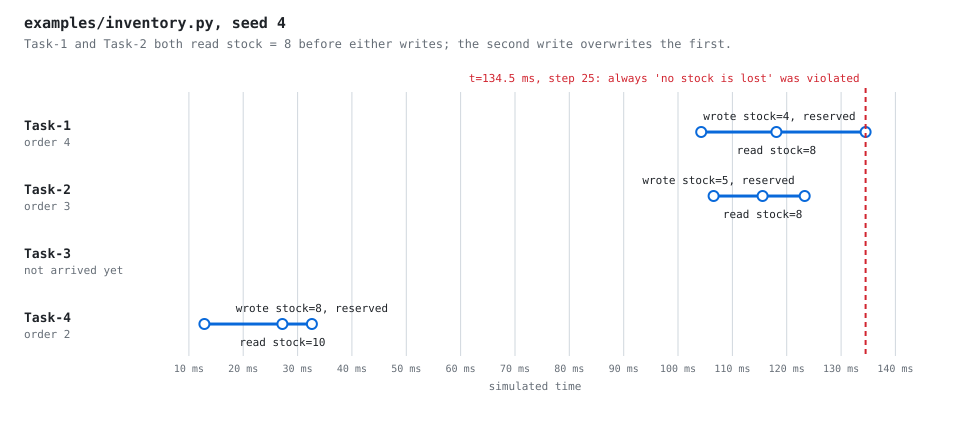

# SimLoop

[](https://github.com/Usman-Siddiqi/SimLoop/actions/workflows/ci.yml)


**Deterministic simulation testing for Python asyncio.**

SimLoop runs your asyncio code on an event loop it fully controls: simulated
time, seeded scheduling, seeded randomness, and (soon) a simulated network
with fault injection. You explore thousands of executions in seconds, and any
failure replays exactly from its seed.

> Status: early development. The deterministic core (loop, clock, scheduling,
> sandboxing, invariants, seed exploration, CLI) works and is tested. The
> simulated network, fault injection and failure minimization are next; see
> [ROADMAP.md](ROADMAP.md).

## Why deterministic simulation testing

Concurrency bugs hide in interleavings that only happen under particular
timing: two requests that overlap by a few milliseconds, a timeout that fires
just before a reply, a retry that races a reconnect. Ordinary tests run one
interleaving, the one your laptop happens to produce, and a failure seen once
in CI is often impossible to reproduce.

Deterministic simulation testing, the approach behind FoundationDB's and
TigerBeetle's test suites, takes every source of non-determinism away from
the OS and gives it to a seeded random generator. Then:

- a run is a pure function of its seed, so every failure is reproducible;
- simulated time costs nothing, so an hour of timeouts and retries runs in milliseconds;
- the scheduler can deliberately explore interleavings instead of waiting for them.

## Example: catching a race and replaying it

[`examples/inventory.py`](examples/inventory.py) is a small shop. Four
customers arrive at random times and reserve stock through a database with
random 2 to 20 ms latency:

```python
async def reserve(self, quantity: int) -> bool:
    stock = await self.db.read_stock()
    if stock < quantity:
        return False
    await self.db.write_stock(stock - quantity)  # stock may have changed since the read
    self.sold += quantity
    return True
```

The test states what must always be true, using the simulation's random
generator for arrival times and latencies:

```python
simloop.always(lambda: db._stock + shop.sold == INITIAL_STOCK, "no stock is lost")
```

Exploring 1000 seeds (output from a real run):

```
$ simloop explore examples/inventory.py:main --seeds 1000 --trace-last 0
1000 runs, 900 passed, 100 failed in 0.48s (2088 runs/s, 772.3s simulated, 31614 steps)

[1] invariant: always 'no stock is lost' was violated
    signature: invariant:no stock is lost
    seeds: 4, 7, 25, 30, 32, 61, 68, 74, 82, 85, ... (100 total)

reproduce [invariant]: simloop run examples/inventory.py:main --seed 4
```

Seed 4 fails the same way every time, and the trace shows why:

```
$ simloop run examples/inventory.py:main --seed 4 --trace-last 14
FAILED (seed 4) after 25 steps, t=0.134520s

invariant: always 'no stock is lost' was violated

Last 14 trace events:
        time    step  actor   event
                      ...     (32 earlier events)
    0.118093      20  Task-1  run      resume inventory.py:30 in Database.read_stock
    0.118093      20  Task-1  log      read stock=8
    0.123308      21  loop    timer    _set_result_unless_cancelled
    0.123308      22  Task-2  run      resume inventory.py:34 in Database.write_stock
    0.123308      22  Task-2  log      wrote stock=5
    0.123308      22  Task-2  log      reserved
    0.123308      22  Task-2  done     returned
    0.123308      23  loop    run      TaskGroup._on_task_done
    0.134520      24  loop    timer    _set_result_unless_cancelled
    0.134520      25  Task-1  run      resume inventory.py:34 in Database.write_stock
    0.134520      25  Task-1  log      wrote stock=4
    0.134520      25  Task-1  log      reserved
    0.134520      25  Task-1  done     returned
    0.134520      25  sim     failed   always 'no stock is lost' was violated

trace digest c1fa8d41d08ee8b6a9d9b0bf09619889
```



Wrapping the read-modify-write in an `asyncio.Lock` fixes it, and the same
1000 seeds confirm the fix:


Both images are generated from real runs by
[`scripts/render_visuals.py`](scripts/render_visuals.py).

## Installation

SimLoop is not on PyPI yet. It needs Python 3.11 or newer and has no runtime
dependencies.

```bash
pip install git+https://github.com/Usman-Siddiqi/SimLoop
```

For development:

```bash
git clone https://github.com/Usman-Siddiqi/SimLoop && cd SimLoop
python -m venv .venv && .venv/bin/pip install -e '.[dev]'
.venv/bin/pytest && .venv/bin/ruff check . && .venv/bin/mypy
```

## Usage

### Python API

```python
import asyncio
import simloop

async def main() -> int:
    await asyncio.sleep(3600)          # returns instantly in wall-clock time
    return simloop.rng().randint(1, 6)  # seeded, recorded randomness

result = simloop.run(main, seed=42)
result.ok, result.value, result.sim_time   # (True, ..., 3600.0)
print(result.trace.format())               # timeline of every step

report = simloop.explore(main, seeds=range(10_000))
print(report.summary())
```

Pass the coroutine *function*, not a coroutine: every run needs a fresh one.
Everything you can do with asyncio works unchanged inside a simulation:
tasks, `gather`, `wait_for`, `asyncio.timeout`, `TaskGroup`, queues, locks,
events, semaphores, conditions, barriers, cancellation, async generators,
context variables, `to_thread` and `run_in_executor`.

Inside a simulation:

| Function | Purpose |
| --- | --- |
| `simloop.now()` | Current simulated time in seconds |
| `simloop.rng()` | A `random.Random` driven by the seed; its draws are recorded |
| `simloop.log(msg)` | Add a line to the trace, attributed to the current task |
| `simloop.always(pred, name)` | `pred()` must hold now and after every step |
| `simloop.eventually(pred, name, within=s)` | `pred()` must become true within `s` simulated seconds (or by the end of the run) |

`SimConfig` controls a run; all of its fields are part of a reproduction:

| Field | Default | Meaning |
| --- | --- | --- |
| `scheduler` | `"random"` | `"random"` explores orderings of ready callbacks; `"fifo"` is exactly asyncio's order |
| `timer_jitter` | `0.0` | Random extra delay (seconds, never negative) added to every timer |
| `max_steps` | `1_000_000` | Fail if the run executes more callbacks than this (livelock guard) |
| `max_time` | `None` | Fail if simulated time would pass this many seconds |
| `sandbox` | `True` | Virtualize time and randomness and reject real I/O |
| `fail_on_unhandled` | `True` | Fail when a background task or callback raises and nobody handles it |

### What counts as a failure

| Kind | Meaning |
| --- | --- |
| `exception` | `main()` raised |
| `invariant` | An `always` or `eventually` property did not hold |
| `deadlock` | Nothing can run and no timer is pending, but tasks are still waiting; the report lists where each is blocked |
| `unhandled` | A background task's exception was never retrieved, or a callback raised |
| `step_limit` / `time_limit` | The run did not finish within its budget |
| `nondeterminism` | Code touched a real socket, DNS, a thread or a subprocess |

Failures are grouped by a signature (failure kind, exception type and the
source line it was raised from, or the property name), so 100 failing seeds
of the same bug show up as one group.

### CLI

```bash
simloop run    path/to/file.py:main --seed 7 [--trace] [--scheduler fifo] [--jitter 0.001]
simloop explore module:main --seeds 10000 [--start 0] [--max-failures 5] [--time-budget 60]
```

Targets are `module:function` or `path/to/file.py:function`. The CLI pins
`PYTHONHASHSEED=0` (re-executing itself if needed) so that set and dict
ordering in the code under test is reproducible across invocations. Exit code
1 means a failure was found.

## How it works

```
 your coroutine ──► SimEventLoop ──────────────┬──► Trace (events + running digest)
                     │ virtual clock           │
                     │ ready queue (batches)   ├──► PropertyChecker (always / eventually)
                     │ timer heap              │
                     ▼                         └──► Sandbox (time, random, os.urandom,
                   Scheduler ◄── ChoiceSource            audit hook for real I/O)
                  (fifo/random)   (seeded, recorded)
```

- **`SimEventLoop`** is written from scratch on `asyncio.AbstractEventLoop`,
  not `BaseEventLoop`, so anything it does not simulate raises instead of
  quietly using a real socket or thread. Like asyncio's own loop, it runs
  ready callbacks in batches; callbacks scheduled during a batch wait for the
  next one. When nothing is ready, the clock jumps straight to the next timer.
- **`ChoiceSource`** is the only source of randomness the framework uses.
  Every decision (which callback runs next, timer jitter, and everything drawn
  from `simloop.rng()`) is a bounded integer drawn from a seeded generator and
  recorded. A run can be replayed from that record instead of the seed, which
  is the basis for shrinking failures. Draws are arranged so that 0 is always
  the simplest choice (FIFO order, no jitter).
- **Scheduling.** `fifo` reproduces asyncio's order exactly; the test suite
  checks this against a real `asyncio.run` of the same program. `random` picks
  uniformly among the current batch, but keeps callbacks scheduled by the same
  step in their registration order, because asyncio guarantees that order and
  real code depends on it.
- **`Sandbox`** patches `time.time`/`monotonic`/`perf_counter`/`sleep` (and
  friends) to read the simulated clock, reseeds the global `random` generator,
  and replaces `os.urandom` (which covers `uuid4`, `secrets` and
  `SystemRandom`). A blocking `time.sleep` stalls the whole simulated loop,
  just as it would stall a real one. A PEP 578 audit hook rejects real
  sockets, DNS lookups, threads and subprocesses and records the leak, so the
  run fails even if the code swallows the exception.
- **Determinism checks.** Every trace event feeds a digest. `explore` reruns
  the first failing seed of each group with a full trace and compares
  digests; a mismatch is reported as leaked non-determinism. The test suite
  checks that the same seed gives identical traces in-process, in separate
  processes, and under different `PYTHONHASHSEED` values. Automatic garbage
  collection is paused during a run and replaced with collections every
  10,000 steps, so finalizers run at reproducible points.

## Limitations

These are current, known gaps rather than design limits unless stated.

- **No simulated network yet.** `open_connection`, `start_server`,
  `getaddrinfo` and friends raise `UnsupportedOperation`. This is the next
  milestone.
- **No fault injection or failure shrinking yet.** The recorded choice
  sequence that shrinking will operate on is already in place.
- **References captured before a run are not virtualized.** `from time import
  monotonic` at import time keeps the real clock. `explore` catches the
  resulting non-determinism after the fact, but cannot prevent it.
- **`datetime.now()` is not virtualized yet.**
- `run_in_executor` and `to_thread` run the function inline (with blocking
  sleeps counted as its duration) instead of on a thread. Code that blocks a
  worker thread waiting for the event loop will deadlock.
- `asyncio.all_tasks()` returns a set whose iteration order depends on object
  addresses; code that iterates it may not be deterministic.
- The `random` scheduler can, in rare cases, produce an ordering that a real
  asyncio loop never would (when the relative order of two callbacks was
  fixed by an earlier, unrelated choice). Failures found only under `random`
  should be checked with `fifo` plus `timer_jitter`, which only produces
  orderings that real timing could cause.
- The sandbox patches module attributes process-wide while a run is active,
  so other threads in the same process see simulated time during a run.

## Findings

SimLoop will be used to test real open-source async libraries. Confirmed,
reproducible results will be listed here; the full log, including suspected
issues and false positives, is in [docs/FINDINGS.md](docs/FINDINGS.md).

No findings yet.

## Project docs

- [ROADMAP.md](ROADMAP.md): milestones and acceptance criteria
- [docs/PROGRESS.md](docs/PROGRESS.md): session-by-session progress log
- [docs/FINDINGS.md](docs/FINDINGS.md): bugs found in real libraries
- [CLAUDE.md](CLAUDE.md): conventions and rules for contributors

## License

MIT. Copyright (c) 2026 Usman Siddiqi. See [LICENSE](LICENSE).
